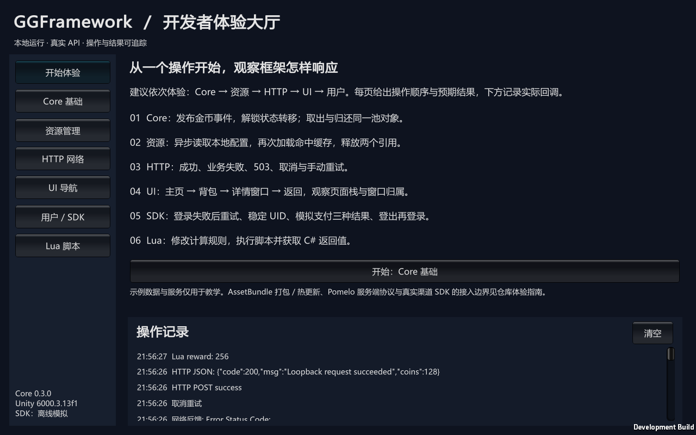

# 开发者体验指南



## 启动

安装 Git 和 Unity 6000.3.13f1 后，单独克隆 Demo 即可：

```powershell
git clone https://github.com/gonglei007/GGFramework-Demo.git
```

Core 由 Unity Package Manager 自动从公开 GitHub 仓库获取，固定依赖为
`https://github.com/gonglei007/GGFramework-Core.git#v0.3.0`。
无需将 Core 放在同级目录，也无需克隆其他模块仓库；其余模块源码继续使用 Demo 内的既有副本。

用 Unity 6000.3.13f1 打开 `unity_project`。选择 **GGFramework → Demo → Play Showcase**。
也可直接打开 `Assets/FrameworkShowcase/Scenes/FrameworkShowcase.unity` 后播放。
场景已加入 Build Settings 并作为默认构建入口，旧 Launcher / Demo 场景仍保留。

大厅不会启动旧 `GameSystem`、Lua 业务入口、热更检查或外部服务器连接。
默认支持 Windows Editor / Windows 桌面 Player。其他桌面平台需匹配的 ToLua 原生插件；
回环 HTTP fixture 使用 TCP，不适用于 WebGL。示例 Bundle 需针对当前目标平台重新生成。

首次导入需要 Git 位于 PATH 中，并能访问 GitHub 和 Unity 包服务。Unity Package Manager 会取得 manifest 中声明的 Core 固定版本与 Unity 包；“离线体验”指完成包解析后运行示例不依赖公网业务服务。若出现 Git executable not found，安装 Git 后重启 Unity Hub；若下载失败，检查 GitHub / Unity 包服务网络连接。

## 操作与预期结果

| 体验页 | 操作顺序 | 观察结果 | 实际 API |
| --- | --- | --- | --- |
| Core | 金币为 0 时进入 Running → 发布金币 → 再进入 | 首次被守卫拒绝，再次成功 | `StateMachine<T>.AddTransitionGuard/ChangeState` |
| Core | 取消订阅 → 发布 → 恢复订阅 → 发布 | 取消后金币不变，恢复后增加一次 | `EventBus.Subscribe/Unsubscribe/Publish` |
| Core | 取出 → 归还 → 再取出 | 日志中的 instanceID 相同 | `GameObjectPool.Get/Release` |
| Core | 后台计算、协程延迟 | 界面继续响应；显示工作线程与主线程编号及完成数 | `TaskSystem.QueueJob`、`MainThreadDispatcher.Post`、`CoroutineUtil` |
| 资源 | 加载两次 → 释放两次 | 引用 1 → 2 → 1 → 0，最后移除缓存 | `LocalResources.LoadAssetAsync`、`ResourceSystem.SetObject/Retain/DestroyObject` |
| 资源 | 加载缺失资源 → 加载正常资源 | 失败状态可恢复，不阻塞后续加载 | 同上 |
| 资源 | Simulation 模拟加载 | 不打包即可读取工程内配置 | `SimulationResources`、`SimplePathInfoParser` |
| 资源 | Build Sample Bundles → 加载真实 AssetBundle | 清单与真实 Bundle 读取成功 | `BundleManifestLoader`、`BundleManager`、`FileAsyncBundleLoaderBuilder`、`BundleResources` |
| HTTP | 成功 200 → 业务失败 409 | 记录 JSON，业务失败显示反馈 | `HttpNetworkSystem.PostWebRequest` |
| HTTP | 服务不可用 503 → 取消 / 重试 → 成功 200 | 取消不会重发；手动重试再次收到 503；后续正常请求成功 | `onWaiting/onResponseError/onDialog` |
| UI | 背包 → 详情 → 关闭所有窗口 → 再开详情 → 返回 | 页面栈恢复 Home，归属背包的窗口隐藏 | `UISystem.PresentPage/ShowWindow/HideAllWindows/DismissPage` |
| 用户 | 注入一次登录失败 → 登录重试 | 收到失败事件，之后登录成功 | `UserSystem.ConfigureSDK/Login/onEvent` |
| 用户 | 支付成功 / 失败 / 取消 → 登出 → 再登录 | 三种事件各触发一次；UID 保持一致 | `ISDK`、`SDKPay/SDKLogout` |
| Lua | 修改倍率 → 执行 | C# 读取修改后的 Lua 返回值；语法错误显示原因 | `LuaState.DoString<string>` |

所有界面操作调用真实框架类。侧栏和操作记录使用 IMGUI，UI 页的页面栈与窗口显示状态由已有 UISystem 驱动。
对象池中的 token 是用于观察复用身份的空 GameObject；没有额外模型或渲染资源依赖。

## 资源示例

配置源文件为 `Assets/FrameworkShowcase/Resources/FrameworkShowcase/Config.json`。
本地后端通过 GGResource 的 Loxodon `LocalResources` 读取它，随后将**运行时 TextAsset 副本**放入 Demo 缓存；
引用计数归零时销毁副本，避免对导入的项目资源调用 `Destroy`。

**Build Sample Bundles** 只构建此配置，输出至 `Assets/StreamingAssets/ShowcaseBundles/`，
使用当前 Build Target，同时生成 Loxodon `BundleManifest`。产物已被现有 `.gitignore` 排除，
切换平台或修改配置后重新构建即可。Simulation 与 Bundle 示例使用 `showcaseconfig@完整资产路径`。

这是本地资源加载与生命周期的最小闭环；生产环境的版本比对、下载、校验、解密、增量更新、回滚，
仍应按 GGResource / Demo 原有发布流程配置，不在大厅中隐式连接旧业务服务。

## HTTP 与 SDK 的边界

HTTP 请求经过 Demo 现有的 `HttpNetworkSystem → TaskSystem → BestHTTP`，
由 `ShowcaseServer` 监听 `127.0.0.1` 的系统分配端口。它提供固定成功、业务失败和 503 响应，
不接收外部网络连接，退出播放时释放监听器。大厅不修改全局生产地址，也不填写真实认证 Token。
此流程不代表独立 GGNetwork 仓库中更新的 UnityWebRequest 后端、HttpDNS 或 Pomelo/WebSocket 服务端联调已被覆盖。

`ShowcaseSDK` 显式注入 Demo `UserSystem`，不会被生产 `SDKFactory` 默认选中。
UID 位于 `Application.persistentDataPath/GGFrameworkShowcase/demo-uid.txt`；不复用旧业务 UID 文件。
支付金额为 0，只发本地回调；真实渠道 SDK 应提供自己的 `ISDK`，在登录前调用 `ConfigureSDK`。
SDK 存在时，UserSystem 不再追加编辑器兜底回调，避免双重登录 / 支付事件。

Lua 页每次创建并释放独立解释器，只运行基础 Lua 规则，不加载旧业务脚本、Unity Lua 模块或远程补丁。

## 自动验证

先执行 **GGFramework → Demo → Build Sample Bundles**，再执行 **Run Smoke Tests** 进入 Play Mode，
执行实际 API 操作并在结束后退出 Play Mode。结果写入 `unity_project/Logs/showcase-smoke-results.txt`。
失败时包含已通过项目和失败原因；单步异步等待有 15 秒超时，总体有 100 秒看门狗。
不要在尚未保存的活动播放会话中执行此命令。

Windows PowerShell 批处理示例（从仓库根执行）：

```powershell
$editor = 'C:\Program Files\Unity\Hub\Editor\6000.3.13f1\Editor\Unity.exe'
$project = Join-Path $PWD 'unity_project'
# 首次或修改资源后构建示例 Bundle。
Start-Process $editor -WindowStyle Hidden -Wait -ArgumentList @(
  '-batchmode', '-nographics', '-quit', '-projectPath', $project,
  '-executeMethod', 'GGFramework.Demo.Editor.ShowcaseTools.BuildSampleBundles',
  '-logFile', "$project/Logs/showcase-bundles.log"
)
# 冒烟测试由回调退出进程，不传 -quit。
Start-Process $editor -WindowStyle Hidden -Wait -ArgumentList @(
  '-batchmode', '-nographics', '-projectPath', $project,
  '-executeMethod', 'GGFramework.Demo.Editor.ShowcaseTools.RunSmokeTests',
  '-logFile', "$project/Logs/showcase-smoke.log"
)
# Core EditMode 测试；manifest 已把 Core 加入 testables。
Start-Process $editor -WindowStyle Hidden -Wait -ArgumentList @(
  '-batchmode', '-nographics', '-projectPath', $project,
  '-runTests', '-testPlatform', 'EditMode',
  '-testResults', "$project/Logs/core-tests.xml",
  '-logFile', "$project/Logs/core-tests.log"
)
```

结果以 Unity 退出码、测试 XML 和冒烟报告为准。旧插件的编译警告不等同于测试失败。

菜单 **Build Windows Showcase** 会构建资源与开发版 Player，输出至 `unity_project/output/showcase/GGFrameworkDemo.exe`（不入库）。正常启动即可体验；自动验证可运行：

```powershell
# 截图需要可见窗口；仅验证逻辑可用 Hidden，但截图可能为黑帧。
Start-Process "$project/output/showcase/GGFrameworkDemo.exe" -WindowStyle Normal -Wait -ArgumentList @(
  '-screen-width', '1280', '-screen-height', '800', '-screen-fullscreen', '0',
  '--showcase-smoke', '--showcase-output', "$project/Logs/player-verification",
  '-logFile', "$project/Logs/showcase-player.log"
)
```

Player 自动测试会写入报告与主要页面截图，然后用 0（成功）或 1（失败）退出。无图形设备时跳过截图；隐藏窗口可能产生黑帧，视觉验收应使用可见窗口。

## 生命周期与重复播放回归

2026-11-20 在 Windows 11 / Unity 6000.3.13f1 实跑修复后版本：Core EditMode 66/66、Editor 冒烟 28/28、Windows x64 Mono Development Player 冒烟 27/27。新增生命周期回归每轮 35 项断言，关闭 Domain Reload 的两个完整播放周期及 Player 均通过，退出码均为 0。[逐轮报告、环境、时间与原始报告摘要](verification-2026-11-20/results.json)。

先构建 Sample Bundles，再执行 **GGFramework → Demo → Run Lifecycle Checks**。完整重复播放检查使用 **Run Lifecycle Checks Twice Without Domain Reload**：先导入检查三个修复 Prefab，再运行两个播放与退出周期，结束后恢复调用前的 Editor 播放设置。批处理以 `GGFramework.Demo.Editor.ShowcaseLifecycleTools.RunWithoutDomainReload` 为 executeMethod，启用图形设备，不传 `-nographics` 或 `-quit`。报告在 `Logs/showcase-lifecycle-cycle-1.txt`、`cycle-2.txt`（完整文件名同前缀）及 `showcase-lifecycle-results.txt`；Editor 真正返回 EditMode 后才退出进程。

开发版 Player 可传 `--showcase-lifecycle --showcase-output <绝对目录>`，回归结束写 `lifecycle-results.txt` 后以 0/1 退出。本次 Player 使用 `-batchmode -nographics`，只验收 API 与生命周期，没有截图或界面视觉结论。

回归检查事件退订、迟到任务结果隔离、池实例销毁、专属 TextAsset 计数与销毁、导入源资产保留、本地 Bundle 卸载、回环端口关闭，以及 UI 登记/页面栈清理和同会话重开；同时断言其他拥有者的 UI 登记仍存在。原始失败及修复后报告一并保留。修复仅作用于本仓库内置副本：独立 GGUI 的公共 RemoveUIBase 契约及其他 Loxodon 副本没有自动变化。

这不证明全工程无内存泄漏、共享资产多拥有者安全、所有在途请求竞态、NGUI/UGUI 视觉一致或生产热更新/渠道支付通过。更完整的项目验收仍须在目标设备和真实服务执行。

## 扩展入口

- `FrameworkShowcase.cs`：场景初始化和各模块操作；`FrameworkShowcase.GUI.cs`：导航、指引与状态呈现。
- `FrameworkShowcase.Bundles.cs`：Simulation / AssetBundle 两个后端。
- `ShowcaseServer.cs`：增加可复现的本机 HTTP 响应。
- `ShowcaseSDK.cs`：增加 SDK 故障注入；`ShowcaseSmoke.cs`：同步增加结果断言。
- `Editor/ShowcaseTools.cs`：打开场景、播放、构建示例资源、批处理验证。

Demo 继续采用现有模块源码副本；修复不会自动传播到独立模块仓库。
共享能力使用公开的 Core v0.3.0 固定标签；SDK 注入与事件修复同时维护 Demo 和独立 GGUser。
